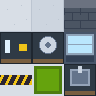

::: {.module-line .content-visible when-format="html"}
**Module 6** · 50 min · [Open the slides for this module](06-worlds-slides.html)
:::

::: {.callout-note title="Learning objectives"}
- Build a map in Tiled with tile layers and an object layer.
- Load a map and make tiles collide by property.
- Place game objects from an object layer.
- Make the camera follow the player in a world bigger than the screen.
:::

## Where you start

[Stopping point C](05-assets.qmd#what-you-have) builds one screen of lab from a list of strings in the code. That's fine for one room. For a whole floor, with decorations, and with someone who isn't a programmer drawing it, you want a **map editor**.

A **tilemap** is a grid of small, reusable images (**tiles**). A **tileset** is the image those tiles come from. *Cold Chain*'s tileset has nine 32 × 32 tiles:

{width="40%" style="image-rendering: pixelated"}

## Tiled

[Tiled](https://www.mapeditor.org) is the free, standard map editor for 2D games. Phaser reads its maps directly.

Open `assets/maps/floor-1.tmj` in Tiled to see the first floor of *Cold Chain*. It has four layers:

| Layer | Kind | What's on it |
|---|---|---|
| `floor` | tiles | the checkered floor |
| `decor` | tiles | hazard tape, the door mat: things you walk over |
| `walls` | tiles | walls, benches, fume hoods: things you can't walk through |
| `objects` | objects | where the player, sample, freezer, carts, spills and dry ice go |

::: {.content-hidden when-format="revealjs"}
Layers draw in order, bottom to top. Splitting "walk over" and "can't walk through" into separate layers means you can switch collisions on for a whole layer at once.
:::

## Make a map in Tiled

1. **File → New → New Map.** Orthogonal, tile size 32 × 32, a fixed map size (40 × 24 tiles).
2. **Map → New Tileset.** Pick `assets/tiles/lab.png`, tile size 32 × 32, and tick **Embed in map**.
3. Add layers in the **Layers** panel: three tile layers and one object layer.
4. Paint with the stamp tool (`B`), fill with the bucket (`F`), erase with `E`.
5. **File → Save As**, as JSON (`.tmj`).

::: {.callout-warning title="Embed the tileset"}
Phaser can't read a tileset saved in its own file (`.tsx`). If your tileset isn't embedded, select it in the **Tilesets** panel and click **Embed Tileset**. The symptom of forgetting is a map that loads with no tiles.
:::

## Say which tiles are solid

Collision belongs to the tile, not the map. In the tileset editor, select a tile, then add a **custom property**: `collides`, a boolean, ticked.

Every wall, bench and hood tile in the lab tileset has `collides: true`. The floor, tape and mat have `false`.

::: {.content-hidden when-format="revealjs"}
The name `collides` isn't special: it's whatever you choose, and Phaser looks it up when you ask. You could call it `solid`, or add a `slippery` property to some tiles and read it in your code.
:::

## Put things on the map

Things that aren't tiles (the player's start, carts, pickups) go on the **object layer**, as points.

- Insert a point with **Insert Point** (`I`).
- Set its **Class** to say what it is: `player`, `sample`, `freezer`, `cart`, `spill`, `dryice`.
- Add custom properties for anything else. Each cart has `axis` (`x` or `y`) and `speed`.

::: {.callout-note title="Class in Tiled, type in Phaser"}
Tiled 1.9 renamed an object's **Type** to **Class** in the editor, but the JSON file still calls it `type`. So you set *Class* in Tiled and read `object.type` in Phaser.
:::

## Load the map

```js
// preload()
this.load.image('lab-tiles', 'tiles/lab.png');
this.load.tilemapTiledJSON('floor-1', 'maps/floor-1.tmj');
```



::: {.content-hidden when-format="revealjs"}
- `make.tilemap` reads the map data. Nothing is drawn yet.
- `addTilesetImage(nameInTiled, imageKey)` connects the tileset **as it's named inside the map** (`lab`) to the image you loaded (`lab-tiles`). Get the first name wrong and the map is invisible (exercise 6.3).
- `createLayer(name, tileset)` draws one layer. Each layer is a game object, with depth, alpha and everything else.
- `setCollisionByProperty({ collides: true })` switches on collision for every tile with that property. Then the layer works with `collider` like any group: `this.physics.add.collider(this.player, this.walls)`.
- The world is now 1280 × 768, bigger than the 960 × 540 screen, so the physics world needs to know its new size.
:::

::: {.callout-warning title="Phaser 3 habit" .phaser3}
Older tutorials use `map.createStaticLayer` and `map.createDynamicLayer`. Both were merged into `map.createLayer` in Phaser 3.50, and Phaser 4 doesn't have them at all.
:::

## Read the objects



::: {.content-hidden when-format="revealjs"}
`getObjectLayer('objects').objects` is a plain array of what you placed in Tiled: each one has `x`, `y`, `type` and `properties`. Three tiny helpers make it pleasant to read: `all('cart')`, `one('freezer')`, and `prop(cart, 'speed')`.

Now the map decides where everything goes, and the code decides what everything does. Move the freezer in Tiled, save, and the game updates: no code changes.

Point objects are the simplest to use, because `x` and `y` are exactly where you clicked. If you place **tile objects** instead (an image of a tile, dropped on the object layer), their `y` is their *bottom* edge, which is a classic source of things appearing half a tile too low.
:::

## A camera that follows

The map is bigger than the screen, so the view has to move. Every scene has a main camera, `this.cameras.main`.



::: {.content-hidden when-format="revealjs"}
- `setBounds` stops the camera at the edges of the map, instead of showing the empty space beyond.
- `startFollow(target, roundPixels, lerpX, lerpY)`. **Lerp** is how much of the gap the camera closes each frame: `1` sticks rigidly to the player, `0.12` eases after them. Easing feels smoother; too little and the player runs off screen.
- `setDeadzone(width, height)` adds a box in the middle of the screen where the player can move without the camera moving at all. Good for platformers; less so here.
- `setZoom(2)` zooms in. Everything, including physics, still works in world coordinates.
:::

## Things that don't scroll

The "Stored" counter should stay in the corner, not scroll away with the world.



::: {.content-hidden when-format="revealjs"}
`setScrollFactor(0)` means "move 0% with the camera": the object stays put on screen. `1` (the default) is normal. Values in between make **parallax**: `0.5` moves at half speed, like a distant background.

For anything more than a label, a separate HUD scene on top of the game is cleaner. That's lesson 7.
:::

## What you have



::: {.callout-tip title="Stopping point D" .stopping-point}
To catch up, copy `stopping-points/stopD` and run it:

```bash
cp -r stopping-points/stopD my-cold-chain-d
cd my-cold-chain-d && npm install && npm run dev
```
:::

## Exercises

::: {.callout-tip title="Exercise 6.1: Build it — a minimap" .exercise #ex-6.1}
Add a minimap in the top-right corner of the screen: the whole floor, about 200 pixels wide, that shows the researcher moving around. Hint: a scene can have more than one camera.

[Answer](../answers/06-worlds-answers.qmd#ex-6.1)
:::

::: {.callout-tip title="Exercise 6.2: Predict it — no bounds" .exercise #ex-6.2}
You delete `cam.setBounds(...)`. What do you see when the researcher walks into the top-left corner of the map? Into the middle?

[Answer](../answers/06-worlds-answers.qmd#ex-6.2)
:::

::: {.callout-tip title="Exercise 6.3: Spot the bug — the invisible lab" .exercise #ex-6.3}
A labmate's game shows the researcher, the carts and the freezer on a plain dark background, and the researcher walks straight through where the walls should be. The console says `Tilemap has no tileset "lab-tiles"`. Here's their code:

```js
const map = this.make.tilemap({ key: 'floor-1' });
const tiles = map.addTilesetImage('lab-tiles', 'lab-tiles');
map.createLayer('floor', tiles);
this.walls = map.createLayer('walls', tiles);
this.walls.setCollisionByProperty({ collides: true });
```

[Answer](../answers/06-worlds-answers.qmd#ex-6.3)
:::

::: {.callout-tip title="Exercise 6.4: Tune it — the camera" .exercise #ex-6.4}
Try lerp values of `1`, `0.12` and `0.02`, and a deadzone of `200 × 120`. Which feels best for *Cold Chain*, and why might a platformer want something different?

[Answer](../answers/06-worlds-answers.qmd#ex-6.4)
:::

::: {.callout-tip title="Exercise 6.5: Build it in Tiled — your own floor" .exercise #ex-6.5}
Open `floor-1.tmj` in Tiled, save a copy as `my-floor.tmj` in your game's `public/assets/maps/`, and change it: move the freezer, add a bench, add a fourth cart with its own `axis` and `speed`. Load your map instead of `floor-1`.

[Answer](../answers/06-worlds-answers.qmd#ex-6.5)
:::

## Key points

- A tilemap is a grid of tiles from a tileset. Draw it in Tiled, save as JSON, and embed the tileset.
- Put "solid" in the tileset as a custom property, and switch it on with `setCollisionByProperty`.
- Use an object layer for where things go. The map decides *where*; the code decides *what*.
- `addTilesetImage(nameInTiled, imageKey)`: the first name must match the map.
- Give the camera bounds and a target. `setScrollFactor(0)` pins things to the screen.

**Next:** [Lesson 7: Scenes and state](07-scenes.qmd)
